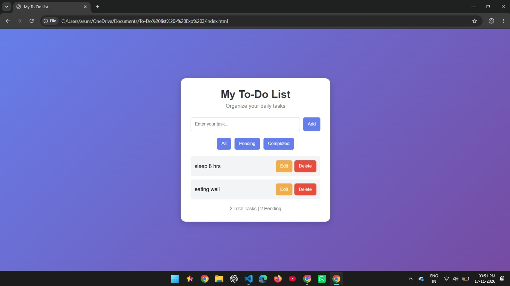

# Ex03 To-Do List using JavaScript
# Date:17-11-2026
# AIM
To create a To-do Application with all features using JavaScript.

# ALGORITHM
# STEP 1
Build the HTML structure (index.html).

# STEP 2
Style the App (style.css).

# STEP 3
Plan the features the To-Do App should have.

# STEP 4
Create a To-do application using Javascript.

# STEP 5
Add functionalities.

# STEP 6
Test the App.

# STEP 7
Open the HTML file in a browser to check layout and functionality.

# STEP 8
Fix styling issues and refine content placement.

# STEP 9
Deploy the website.

# STEP 10
Upload to GitHub Pages for free hosting.

# PROGRAM  
```
<!DOCTYPE html>
<html lang="en">
<head>
    <meta charset="UTF-8">
    <meta name="viewport" content="width=device-width, initial-scale=1.0">
    <title>My To-Do List</title>
    <link rel="stylesheet" href="style.css">
</head>
<body>

    <div class="container">
        <h1>My To-Do List</h1>
        <p class="subtitle">Organize your daily tasks</p>

        <div class="input-section">
            <input type="text" id="taskInput"
                   placeholder="Enter your task...">
            <button id="addBtn" onclick="addTask()">Add</button>
        </div>

        <div class="filters">
            <button onclick="filterTasks('all')">All</button>
            <button onclick="filterTasks('pending')">Pending</button>
            <button onclick="filterTasks('completed')">Completed</button>
        </div>

        <ul id="taskList"></ul>

        <p id="taskCount">No tasks available</p>
    </div>

    <script src="script.js"></script>
</body>
</html>

* {
    margin: 0;
    padding: 0;
    box-sizing: border-box;
}

body {
    font-family: Arial, sans-serif;
    background: linear-gradient(135deg, #667eea, #764ba2);
    min-height: 100vh;
    display: flex;
    justify-content: center;
    align-items: center;
}

.container {
    background: white;
    width: 90%;
    max-width: 450px;
    padding: 30px;
    border-radius: 15px;
    box-shadow: 0 5px 20px rgba(0,0,0,0.2);
}

h1 {
    text-align: center;
    color: #333;
    margin-bottom: 8px;
}

.subtitle {
    text-align: center;
    color: #777;
    margin-bottom: 25px;
}

.input-section {
    display: flex;
    gap: 10px;
}

input {
    flex: 1;
    padding: 12px;
    border: 1px solid #ccc;
    border-radius: 6px;
    outline: none;
}

button {
    padding: 10px 14px;
    border: none;
    border-radius: 6px;
    cursor: pointer;
    background: #667eea;
    color: white;
}

button:hover {
    opacity: 0.85;
}

.filters {
    display: flex;
    justify-content: center;
    gap: 10px;
    margin: 20px 0;
}

#taskList {
    list-style: none;
}

#taskList li {
    display: flex;
    align-items: center;
    justify-content: space-between;
    background: #f3f4f6;
    padding: 12px;
    margin-bottom: 10px;
    border-radius: 6px;
    gap: 8px;
}

.task-text {
    flex: 1;
    overflow-wrap: anywhere;
}

.completed .task-text {
    text-decoration: line-through;
    color: gray;
}

.actions {
    display: flex;
    gap: 5px;
}

.edit-btn {
    background: #f0ad4e;
}

.delete-btn {
    background: #e74c3c;
}

#taskCount {
    text-align: center;
    color: #777;
    margin-top: 20px;
    font-size: 14px;
}


let tasks = JSON.parse(localStorage.getItem("tasks")) || [];
let currentFilter = "all";

// Save tasks in Local Storage
function saveTasks() {
    localStorage.setItem("tasks", JSON.stringify(tasks));
}

// Add a new task
function addTask() {
    let input = document.getElementById("taskInput");
    let taskName = input.value.trim();

    if (taskName === "") {
        alert("Please enter a task!");
        return;
    }

    tasks.push({
        id: Date.now(),
        text: taskName,
        completed: false
    });

    input.value = "";
    saveTasks();
    displayTasks();
}

// Display tasks
function displayTasks() {
    let taskList = document.getElementById("taskList");
    taskList.innerHTML = "";

    let filteredTasks = tasks.filter(task => {
        if (currentFilter === "pending")
            return !task.completed;

        if (currentFilter === "completed")
            return task.completed;

        return true;
    });

    filteredTasks.forEach(task => {
        let li = document.createElement("li");

        if (task.completed) {
            li.classList.add("completed");
        }

        let span = document.createElement("span");
        span.className = "task-text";
        span.textContent = task.text;
        span.onclick = () => toggleTask(task.id);

        let actions = document.createElement("div");
        actions.className = "actions";

        let editBtn = document.createElement("button");
        editBtn.className = "edit-btn";
        editBtn.textContent = "Edit";
        editBtn.onclick = () => editTask(task.id);

        let deleteBtn = document.createElement("button");
        deleteBtn.className = "delete-btn";
        deleteBtn.textContent = "Delete";
        deleteBtn.onclick = () => deleteTask(task.id);

        actions.appendChild(editBtn);
        actions.appendChild(deleteBtn);

        li.appendChild(span);
        li.appendChild(actions);

        taskList.appendChild(li);
    });

    let pending = tasks.filter(task => !task.completed).length;

    document.getElementById("taskCount").textContent =
        `${tasks.length} Total Tasks | ${pending} Pending`;

}

// Mark task as completed or pending
function toggleTask(id) {
    tasks = tasks.map(task => {
        if (task.id === id) {
            task.completed = !task.completed;
        }
        return task;
    });

    saveTasks();
    displayTasks();
}

// Edit a task
function editTask(id) {
    let task = tasks.find(task => task.id === id);

    let newText = prompt("Edit your task:", task.text);

    if (newText !== null && newText.trim() !== "") {
        task.text = newText.trim();
        saveTasks();
        displayTasks();
    }
}

// Delete a task
function deleteTask(id) {
    if (confirm("Are you sure you want to delete this task?")) {
        tasks = tasks.filter(task => task.id !== id);
        saveTasks();
        displayTasks();
    }
}

// Filter tasks
function filterTasks(filter) {
    currentFilter = filter;
    displayTasks();
}

// Add task when Enter key is pressed
document.getElementById("taskInput").addEventListener("keypress", function(event) {
    if (event.key === "Enter") {
        addTask();
    }
});

// Initial display
displayTasks();
```
# OUTPUT



# RESULT:
The program for creating To-do list using JavaScript is executed successfully.
